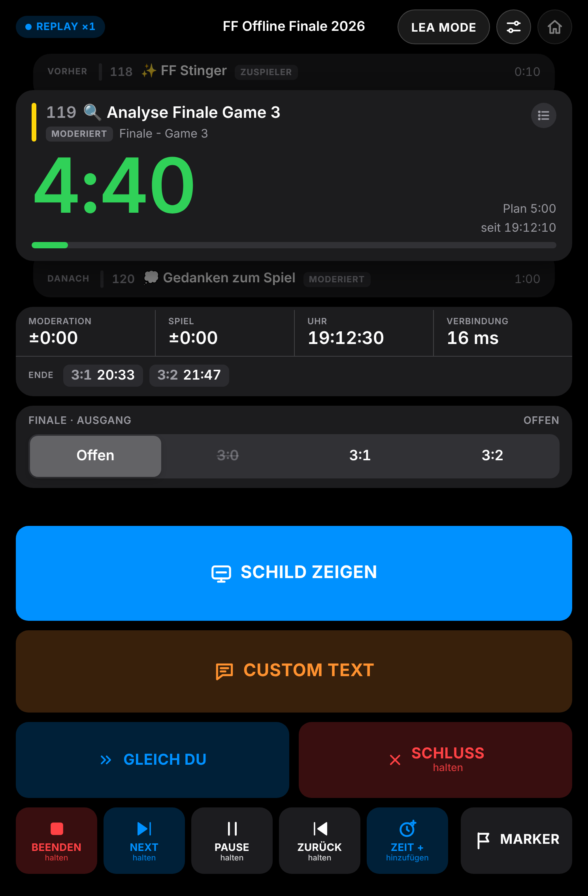
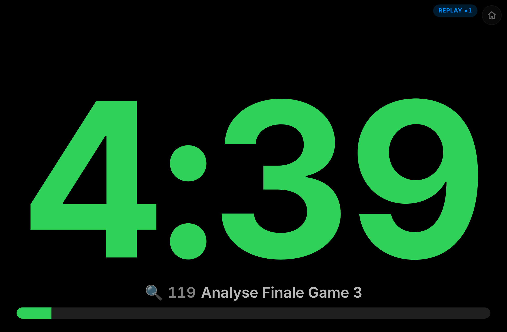
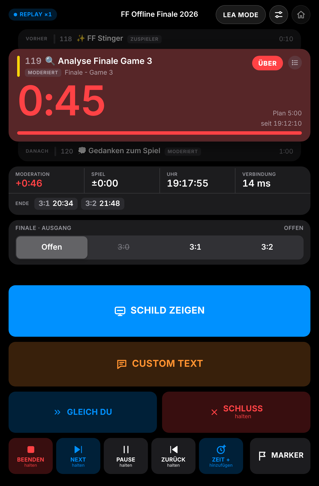
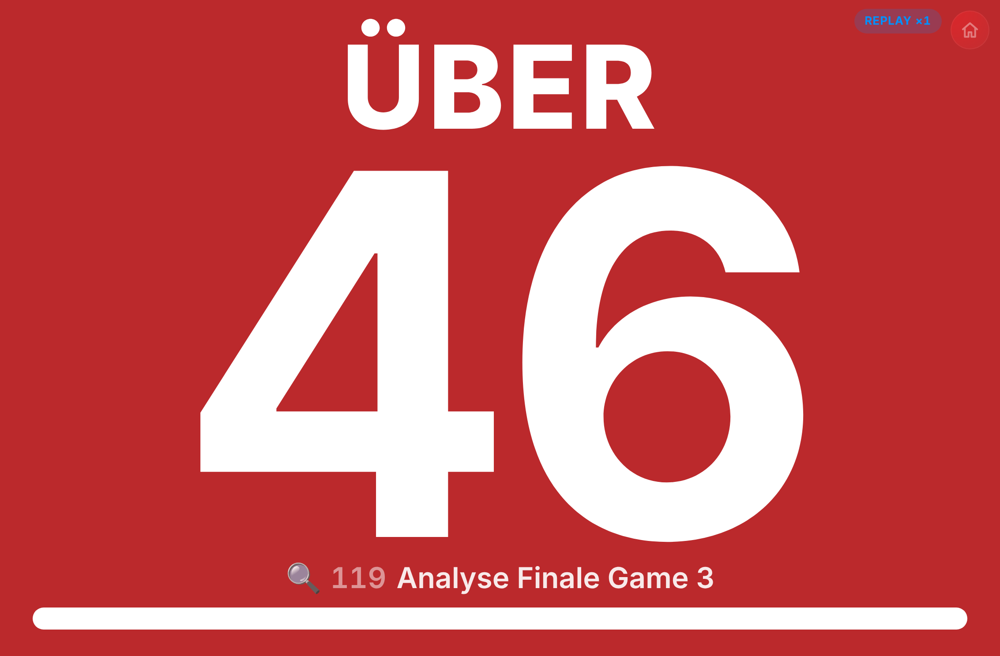
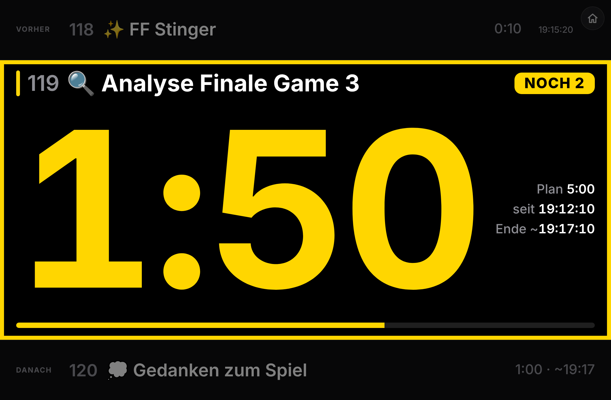
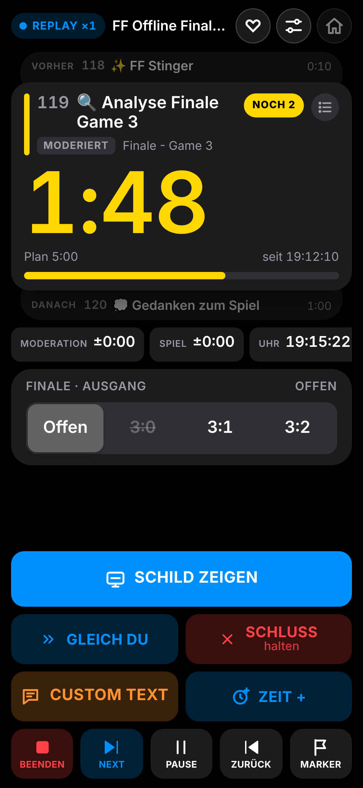
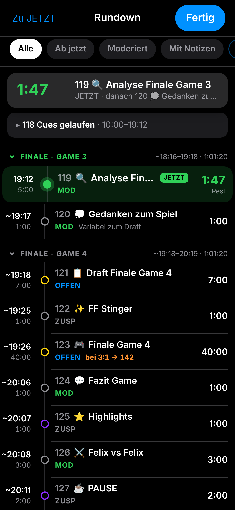
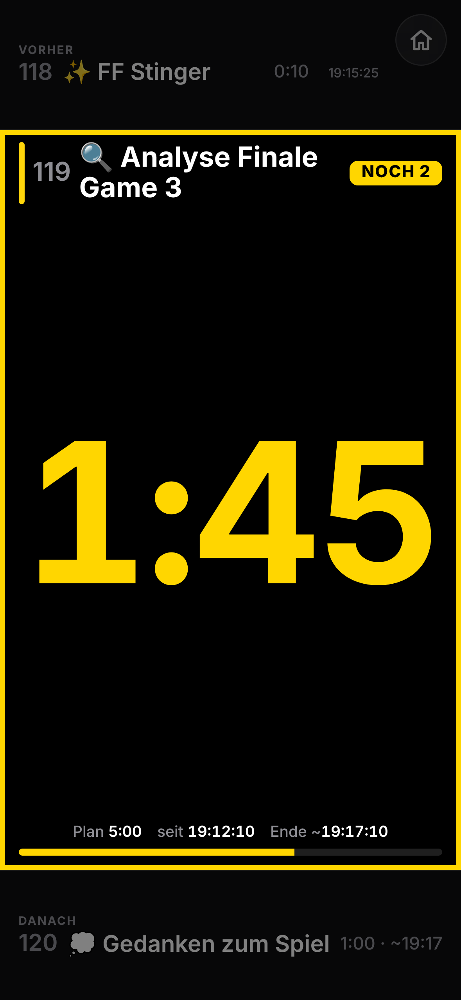
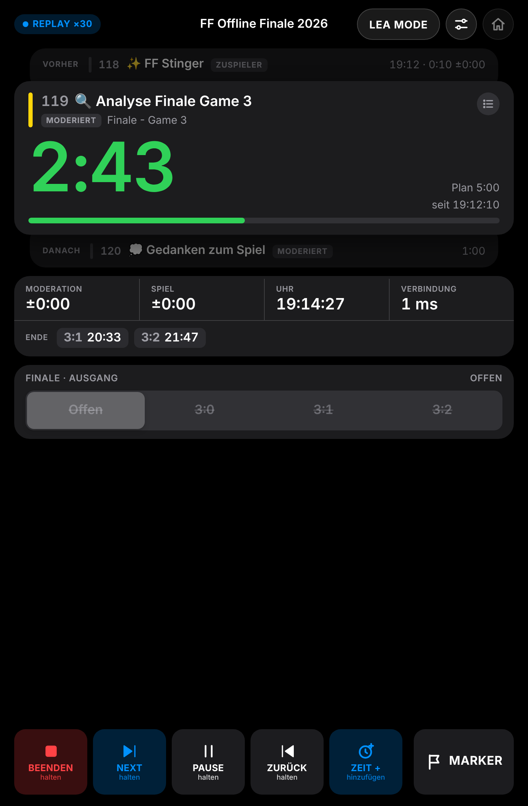

# FF Aufnahmeleitung

Web-App (PWA) für die Aufnahmeleitung auf dem **iPad mini (6./7. Gen.)**. Die AL steht neben der Kamera, liest den aktuellen Cue aus dem Rundown und zeigt dem Moderator auf einem großen Schild, wie viel Zeit er noch hat.

- **Hochkant:** Bedienansicht. Oben steht der aktuelle Cue mit Restzeit, halbtransparent dahinter der vorherige (mit Ist-Dauer) und der nächste Cue, darunter Salden und Back-Time, unten die Buttons in der Daumenzone.
- **Quer:** Schild für den Moderator. Die Restzeit ist so groß wie möglich: grün, gelb mit Rahmen bei den Warnstufen, orange mit FERTIG WERDEN in den letzten 10 s und rot pulsierend beim Überziehen. Auf Knopfdruck zeigt es zusätzlich einen eigenen Text, auf Wunsch mit GIF.
- **Relay-Server:** pollt die Rundown-API, hält eine gemeinsame Uhr und verteilt den Zustand per WebSocket an alle Geräte.

| Bedienung (hoch) | Schild (quer) |
| --- | --- |
|  |  |
|  |  |

Weitere Zustände liegen in [`docs/screenshots`](docs/screenshots): Rundown-Tabelle, NOCH 2, FERTIG WERDEN, ZEIT-+-Drehrad, CUSTOM TEXT, SCHLUSS, GLEICH DU, Spiel, Anker-Pause, Querformat, helles Erscheinungsbild und Einstellungen.

---

## Schnellstart

```bash
npm install
npm run replay          # Test ohne Show: spielt den Rundown "FF Offline Finale 2026" ab
# → http://localhost:8080/al   (Bedienung)
#   http://localhost:8080/schild (Schild auf zweitem Gerät)
#   http://localhost:8080/regie  (Regie: Cue-Stapel, Strecken, Rundown-Steuerung, Marker)
```

Live gegen das Rundown-Tool:

```bash
cp .env.example .env    # RUNDOWN_TOKEN eintragen, MODE=live
npm start
```

Der Token liegt nur in `.env` auf dem Server und erreicht nie das iPad. `.env` ist in `.gitignore` eingetragen, weil dieses Repo öffentlich ist.

Node.js ≥ 20 wird vorausgesetzt. Einzige Abhängigkeit ist `ws`.

## Am Showtag

1. **HTTPS einrichten.** Wake Lock (Display bleibt an), Offline-Cache und die Homescreen-App funktionieren auf dem iPad nur über HTTPS. Zwei Wege:
   - **Show-Laptop im Produktionsnetz:** Mit [mkcert](https://github.com/FiloSottile/mkcert) ein Zertifikat für die IP des Laptops erzeugen (`mkcert 192.168.1.20`). `TLS_CERT` und `TLS_KEY` in `.env` setzen. Das Root-Zertifikat (`mkcert -CAROOT`) per AirDrop aufs iPad schicken und unter *Einstellungen › Allgemein › VPN und Geräteverwaltung* installieren. Danach unter *Info › Zertifikatsvertrauen* auf vollständiges Vertrauen stellen.
   - **Server im Internet** hinter einem HTTPS-Proxy. Dafür unbedingt `ACCESS_KEY` setzen und das iPad einmal mit `/al?key=…` öffnen; der Schlüssel bleibt im Gerät gespeichert.
   - **Synology NAS:** siehe [Betrieb auf einer Synology](#betrieb-auf-einer-synology).
2. **Homescreen-App anlegen:** Auf dem iPad `/al` öffnen und *Teilen › Zum Home-Bildschirm* wählen. Wake Lock funktioniert in der Homescreen-App ab iPadOS 18.4.
3. **iPad vorbereiten:** Dauerstrom (die Show dauert fast 12 h, der Akku hält laut Apple bis zu 10 h), *Automatische Sperre: Nie*, *Geführter Zugriff* an, True Tone und Night Shift aus, Helligkeit fest auf Maximum. Die *Ausrichtungssperre* bleibt aus, denn Drehen ist der Moduswechsel.
4. **Uhr prüfen:** Unter *Einstellungen › Uhr-Abgleich* sollte die Genauigkeit im WLAN unter ±50 ms liegen. Der Server braucht NTP.

## Betrieb auf einer Synology

Der Server läuft im Container auf dem NAS. DSM übernimmt HTTPS mit einem Let's-Encrypt-Zertifikat, das iPad erreicht die App dann über WLAN oder Mobilfunk.

1. **Dateien aufs NAS:** Das Repo als ZIP herunterladen und z. B. nach `/docker/al-tool` entpacken. Daneben eine `.env` mit `MODE=live`, `RUNDOWN_TOKEN=…` und einem langen `ACCESS_KEY=…` anlegen. `TLS_CERT` und `TLS_KEY` bleiben leer.
2. **Container starten:** *Container Manager › Projekt › Erstellen*, Pfad `/docker/al-tool` wählen. Die vorhandene `docker-compose.yml` wird übernommen.
3. **Adresse und Zertifikat:**
   - DDNS einrichten unter *Systemsteuerung › Externer Zugriff › DDNS*, z. B. `name.synology.me`.
   - Ein Let's-Encrypt-Zertifikat dafür anlegen unter *Sicherheit › Zertifikat*.
4. **Reverse Proxy:** unter *Systemsteuerung › Anmeldeportal › Erweitert › Reverse Proxy*.
   - Quelle: HTTPS, `name.synology.me`, Port `8443`.
   - Ziel: HTTP, `localhost`, Port `8080`.
   - Unter *Benutzerdefinierte Kopfzeile › Erstellen › WebSocket* eintragen; ohne diesen Schritt bleibt das iPad „OFFLINE“.
   - Dem Eintrag unter *Sicherheit › Zertifikat › Einstellungen* das Let's-Encrypt-Zertifikat zuweisen.
5. **Router:** TCP-Port `8443` an das NAS weiterleiten.
6. **iPad:** `https://name.synology.me:8443/al` öffnen und *Zum Home-Bildschirm* wählen. Beim ersten Start fragt die App nach dem Zugangsschlüssel.

Ohne offenen Port geht es auch mit Tailscale, das es als Synology-Paket und als iPad-App gibt. Dann ist das NAS nur für eigene Geräte erreichbar.

Am Set braucht das iPad Internet. Fällt es aus, zählt das Schild weiter, und nach 10 s lassen sich die Cues lokal schalten.

## Bedienung

**Startseite (`/`):** Die Modusauswahl zeigt oben das FrankenFinals-Logo, Show, Verbindung (Live/Replay), Uhrzeit und den laufenden Cue mit Restzeit. Darunter die vier Modi als Kacheln: Aufnahmeleitung, Schild, Regie und Vollbild-Stapel; der zuletzt genutzte Modus ist markiert. In jedem Modus führt das halb transparente Häuschen oben rechts zurück zu dieser Auswahl. Die Einstellungen öffnet in Aufnahmeleitung und Regie der Regler-Button daneben.

| Button | Wirkung | Auslösen |
| --- | --- | --- |
| Cue-Kasten oben | Öffnet den kompletten Rundown als Zeitleiste: links die Zeit (Ist bzw. ~erwartet, darunter Plan), in der Mitte eine Linie mit Punkten (gelaufen · jetzt · kommt), rechts Ist-Dauer und Abweichung bzw. Restzeit. Gelaufene Cues und vom Szenario übersprungene Cues sind zugeklappt, Block-Köpfe zeigen Zeitraum und Dauer, oben bleibt die Jetzt-Karte stehen. Filter: Alle · Ab jetzt · Moderiert · Mit Notizen. Tipp auf eine Block-Überschrift klappt alle Cues des Blocks ein oder aus; „Alle Blöcke zu/auf“ klappt alle Blöcke auf einmal. Tipp auf eine Zeile zeigt Notizen, eigene Spalten, Ist-Start/-Ende und Streckung | Tippen |
| SCHILD ZEIGEN | Schild auch im Hochformat. Verlassen: 1 s irgendwo halten | Tippen |
| CUSTOM TEXT | Öffnet einen Editor für einen eigenen Text auf dem Schild: fett, kursiv, unterstrichen, sechs Farben, GROSSBUCHSTABEN, Schnelltexte und ein GIF von Giphy. Solange der Text steht, ist der Button gefüllt und die Bedienansicht zeigt ihn mit AUSBLENDEN | Tippen, dann *Anzeigen* |
| GLEICH DU | Schild blau, z. B. kurz vor Ende eines Spiels | Tippen |
| SCHLUSS | Schild rot mit „SCHLUSS“; erneut halten hebt auf | 0,6 s halten |
| START ▶ / BEENDEN ⏹ | Ein Button für beides: grün START, solange der Rundown nicht läuft; nach dem Start rot BEENDEN; nach dem Beenden wieder grün START | 0,6 s halten |
| NEXT ⏭ | Schaltet im Backend auf den nächsten Cue | 0,6 s halten |
| PAUSE ⏸ / PAUSIERT ⏹ | Toggle (`action=toggle`): Halten pausiert den Rundown, der Button wird orange mit Stop-Symbol und „PAUSIERT“; fortgesetzt wird **nur** durch erneutes Halten von PAUSE. Während der Pause sind NEXT und ZURÜCK gesperrt, der linke Button bleibt BEENDEN | 0,6 s halten |
| ZURÜCK ⏮ | Schaltet im Backend auf den vorherigen Cue | 0,6 s halten |
| ZEIT + | Öffnet die Zeit-Auswahl: Schnellwahl 0:30 / 1:00 / 2:00 / 5:00 stellt die Drehräder (Min : Sek, je 00–99). Dann **„Um MM:SS erweitern“** (Zeit hinzufügen) oder **„Auf MM:SS setzen“** (Restzeit setzen). Beides gilt sofort auf iPad und Schild und wird an das Rundown-Backend übertragen (`action=add` bzw. `action=set`, `time=MM:SS`) | Tippen, dann bestätigen |
| MARKER | Eintrag für Nachbericht und Resolve (ganz rechts in der unteren Reihe) | Tippen |
| MANUELL ◀ ▶ | Erscheint erst, wenn die Quelle oder der Relay 10 s ausfällt | 0,6 s halten |

**Rundown steuern:** Die untere Reihe schaltet den Rundown auf rundown.ffverwaltung.de über dessen Companion-Schnittstelle (`/api/public/companion?action=next|toggle|prev|finish`). Der Relay ruft sie mit dem `RUNDOWN_TOKEN` auf, das iPad sieht den Token nie. Dieselbe Aktion innerhalb von 0,8 s zählt nur einmal, damit ein Doppeltipp nicht zwei Cues weiterschaltet. Im Replay werden die Aktionen nachgespielt.

**Zeit im Backend:** Erweitern und Setzen wirken sofort lokal. Übernimmt das Backend die Änderung (neue Dauer oder neuer Startpunkt des Cues), nimmt der Relay die lokale Streckung in den folgenden 20 s um genau diesen Betrag zurück, damit nichts doppelt zählt. Scheitert die Übertragung, bleibt die lokale Änderung bestehen und die App meldet „Zeit nicht übertragen – gilt nur hier“.

**Szenarien:** In den Verzweigungsblöcken (SuP3 ab Cue 27, Finale ab Cue 88) erscheint eine Auswahl wie *Offen | 3:0 | 3:1 | 3:2*. Solange „Offen“ gewählt ist, zeigt die Back-Time alle möglichen Enden. Die Wahl gilt sofort und lässt sich 5 s lang über „Widerrufen“ zurücknehmen.

**LEA MODE:** Der Button oben rechts links neben den Einstellungen schaltet alle Farben auf Pastell um (rosé, lila, orange, pink), auch auf dem Schild. Erneut tippen stellt die normalen Farben wieder her. Die Einstellung gilt pro Gerät; Wort und Form der Schild-Zustände bleiben gleich.

**Griffhand:** In den Einstellungen lassen sich die Spalten spiegeln, damit CUSTOM TEXT und SCHLUSS auf der Daumenseite liegen.

### Vollbild-Stapel (`/stapel`)

Vorheriger, aktueller und nächster Cue als drei Bänder, ohne Bedienelemente und aus mehreren Metern lesbar: oben abgedunkelt der vorherige Cue (Ist-Dauer, Abweichung, Uhrzeit), in der Mitte groß der aktuelle Cue mit Zustandswort, Restzeit, Plan, Start und erwartetem Ende, unten der nächste Cue mit erwarteter Startzeit. Farben und Zustände wie auf dem Schild; bei einem Cue-Wechsel rutschen die Bänder nach oben. Custom Text erscheint als Banner, „Nur Text“ ersetzt die Zeit.

- **Eigenes Gerät:** `/stapel` öffnen (Startseite › Vollbild-Stapel).
- **Aus AL und Regie:** Einstellungen › „Vollbild-Stapel zeigen“; 1 s halten schließt ihn.
- **Regie auf dem iPhone:** quer gedreht erscheint der Stapel automatisch.



### iPhone

Unter 600 pt Breite (hochkant) gibt es eine Kompaktansicht: Cue-Stapel oben, Status als wischbare Chips, Szenario-Wahl und Hinweise dazwischen, die Steuerung fest unten in der Daumenzone (SCHILD ZEIGEN · GLEICH DU | SCHLUSS · CUSTOM TEXT | ZEIT + · START/BEENDEN, NEXT, PAUSE, ZURÜCK, MARKER). „halten“ zeigt dort der Füllring beim Drücken. Die Rundown-Zeitleiste öffnet sich als Vollbild-Sheet.

| Bedienung | Rundown | Stapel |
| --- | --- | --- |
|  |  |  |

### Regieansicht (`/regie`)

Wie in der Bedienansicht ist der aktuelle Cue das Hauptelement. Darüber liegt halbtransparent der vorherige Cue (Start, Ist-Dauer, Abweichung), darunter der nächste (Dauer, ggf. SPRUNG). Unten gibt es die Reihe START/BEENDEN · NEXT · PAUSE · ZURÜCK (jeweils halten) · ZEIT + · MARKER. Im Querformat bleibt es eine Spalte: oben der Cue-Stapel in derselben Größe, darunter die Buttons, dann Status und Hinweise. Schild, Custom Text, GLEICH DU, SCHLUSS und die Szenario-Wahl bleiben der AL vorbehalten.



### Zustände des Schilds

Jeder Zustand ist dreifach erkennbar: über Farbe, Form und Wort. Damit bleibt er auch bei Rot-Grün-Schwäche eindeutig.

| Zustand | Farbe | Form | Wort |
| --- | --- | --- | --- |
| läuft | Grün | nur Ziffern | – |
| Warnstufe (5/2/1 min, 30 s) | Gelb | dicker Rahmen, pulst beim Eintritt 3× | NOCH 2 … |
| letzte 10 s | Orange | Kreispfeil | FERTIG WERDEN |
| überzogen | Rot | volle Fläche, 1 Hz gedimmt (WCAG 2.3.1) | ÜBER |
| SCHLUSS | Rot | volle Fläche, Kreuz | SCHLUSS |
| GLEICH DU | Blau | – | GLEICH DU |
| Zuspieler, Pause | Grau | – | ZUSPIELER / PAUSE |
| Spiel/Draft | sehr dunkel | zählt hoch | – |

### Eigener Text und GIFs

Unter dem Editor wählt *Auf dem Schild* zwischen **Text + Restzeit** (Standard) und **Nur Text**. Bei *Nur Text* zeigt das Schild ausschließlich den Custom Text auf Schwarz, ohne Restzeit, Cue-Zeile, Balken und Zustandsfarbe; die Bedienansicht markiert das mit „nur Text“.

Der Text erscheint im Schild über der Restzeit und wird automatisch so groß gesetzt, wie der Platz erlaubt. Formatierungen werden auf dem Gerät und noch einmal auf dem Schild auf eine feste Liste (fett, kursiv, unterstrichen, Farben) reduziert; fremdes HTML kommt nicht durch.

GIFs kommen ausschließlich von Giphy und laufen über das offizielle [Giphy-SDK für JavaScript](https://developers.giphy.com/docs/sdk/):

- **Suchen, ansehen, auswählen:** Das Gitter im Editor ist `@giphy/js-components` (Masonry, lädt beim Scrollen nach). Ohne Suchbegriff zeigt es die Trends, umschaltbar zwischen *GIFs* und *Sticker*. Ein Tipp wählt das GIF aus.
- **Schlüssel bleibt auf dem Server:** Die Daten holt der Relay mit `@giphy/js-fetch-api` unter `/api/giphy`. Den kostenlosen Schlüssel von [developers.giphy.com](https://developers.giphy.com) als `GIPHY_API_KEY` eintragen (`.env` oder `environment` im Compose-Projekt) und den Container neu starten. Gesucht wird mit Jugendschutzstufe `pg-13`.
- **Link einfügen** (z. B. `https://giphy.com/gifs/…`) funktioniert auch ohne Schlüssel.
- Das Browser-Bundle liegt fertig unter `public/vendor/giphy.js`. Nach einem SDK-Update neu bauen: `npm run build:giphy`.

Eine Warnstufe erscheint nur, wenn sie höchstens die halbe Cue-Länge beträgt. Ein 3-min-Cue zeigt also 1:00 und 0:30, ein 15-s-Cue nur den Überzug. Ist auf dem iPad „Bewegung reduzieren“ aktiv, entfällt das Pulsieren.

Unter den Ziffern steht klein der aktuelle Cue mit Emoji, Nummer und Titel, damit der Moderator sieht, wo die Show gerade steht.

Die Ziffern wachsen, je knapper die Zeit wird: MM:SS ab 10 min, M:SS darunter, in der letzten Minute nur noch Sekunden. `fitText` misst die Schrift und füllt die verfügbare Breite bzw. Höhe.

## Konfiguration

| Datei | Inhalt |
| --- | --- |
| `.env` | Modus, Token, Port, HTTPS, Zugangsschlüssel, Polling (siehe `.env.example`) |
| `config/cue-kinds.json` | Cue-Arten aus dem Titel: `moderated`, `fixed`, `open`, `special`, `anchor`. Overrides nach Cue-Nummer, z. B. Cue 65 als Anker bis 15:45:15. Außerdem die Emojis je Cue (`emojis`, Rückfall `emojiByKind`), die die Bedienansicht vor den Titel setzt |
| `config/scenarios.json` | Verzweigungen (SuP3 2:0 → nach Cue 40 weiter mit 52; Finale 3:0/3:1 → weiter mit 142) |

Die Rundown-API liefert keine Cue-Art. Wird der Rundown umgebaut, die Regeln in `cue-kinds.json` prüfen.

### Startzeit eines Cues

Aus `/current` ist noch nicht bekannt, ob es ein Startzeit-Feld gibt. Der Relay versucht deshalb nacheinander:

1. ein Zeitstempel-Feld im `current`-Objekt (`startedAt`, `actualStart` …),
2. `liveSinceSeconds`, sofern es sich auf den Cue bezieht und nicht auf die Show,
3. eigene Beobachtung beim Cue-Wechsel (Genauigkeit ±0,5 s bei 500 ms Polling).

Was gerade genutzt wird, zeigt *Einstellungen › Cue-Startzeit aus*. Die Rohantwort der API steht unter `/api/debug/source`. Festlegen lässt sich die Quelle über `CUE_START_SOURCE=observed | liveSince | field:<name>`.

### Neustart der Show

Startet die Show im Rundown-Backend neu, setzt der Relay alles zurück, was zum alten Lauf gehört: Streckungen, Cue-Startzeiten, Salden, Signale, Szenario-Wahl und Custom Text. Als Neustart gilt:

1. ein neuer, frischer `showStartedAt` (höchstens 15 min alt; auch wenn der Relay zwischendurch aus war),
2. die Show war mindestens 1,5 s gestoppt und läuft wieder,
3. die Show springt mitten im Lauf zurück auf den ersten Cue.

Springt das Backend auf einen späteren Cue zurück, verliert nur dieser Cue seine alte Streckung. Nachbericht und Marker-Export enthalten nur den aktuellen Lauf; das vollständige Log bleibt unter `/api/log`.

## Exporte

- **Nachbericht:** `/api/export/report.csv`. Enthält Plan- und Ist-Zeiten je Cue, Streckungen, Abweichungen sowie alle Signale und Marker (Semikolon-getrennt, öffnet direkt in Excel).
- **DaVinci Resolve:** `/api/export/markers.edl?fps=25`. Import über *Timeline › Import › Timeline Markers from EDL*.
  - Standardmäßig ist der erste Cue 01:00:00:00. Mit `start=HH:MM:SS` lässt sich der Aufnahmestart setzen, mit `tc=tod` wird Uhrzeit-Timecode verwendet.
  - Farben: Cue blau, Marker gelb, SCHLUSS rot, eigener Text pink, Streckung türkis, Szenario lila.

Beide Exporte sind auch über die Einstellungen erreichbar.

## Ausfälle

| Ausfall | Verhalten |
| --- | --- |
| Rundown-API antwortet nicht | Anzeige läuft weiter, Hinweis „QUELLE m:ss“; nach 10 s erscheint MANUELL, die AL schaltet am Relay weiter |
| Relay/WLAN weg | iPad zählt mit der zuletzt abgeglichenen Uhr weiter, Hinweis „OFFLINE“. Nach 10 s ist ein lokaler Modus möglich; Marker werden nachgereicht |
| Seite neu geladen | Zustand liegt im Relay (`data/state.json`), alles ist sofort wieder da |
| Relay neu gestartet | Zustand und Log werden aus `data/` geladen |
| Rundown pausiert | Zeit steht, Hinweis „PAUSIERT“ |

## Gestaltung nach SwiftUI / Human Interface Guidelines

Die Oberfläche ist eine Web-App, folgt aber den Vorgaben von [SwiftUI](https://developer.apple.com/documentation/swiftui) und den [Human Interface Guidelines](https://developer.apple.com/design/human-interface-guidelines). Die Umsetzung im Web:

| SwiftUI / HIG | Web |
| --- | --- |
| `VStack`/`HStack`/`Grid`, Safe Area | CSS Grid/Flex, `env(safe-area-inset-*)`, 20 pt Rand, 8-pt-Raster |
| Size Classes, Ausrichtung | `@media (orientation)`; hoch Bedienung, quer zweispaltig bzw. Schild |
| `Font.TextStyle`, Dynamic Type | Textstile mit HIG-Größen, in Safari `font: -apple-system-body` usw. |
| `.monospacedDigit()` | `font-variant-numeric: tabular-nums` |
| Systemfarben, semantische Farben | Tokens mit den HIG-Werten für Dunkel, Hell und *Erhöhter Kontrast* |
| Farbe nicht als einzige Information | Jeder Zustand mit Wort und Form |
| `accessibilityReduceMotion` | `prefers-reduced-motion` |
| `.buttonStyle(.bordered/.borderedProminent)` | getönte bzw. gefüllte Buttons, gedimmt beim Drücken |
| `Picker(.segmented)`, `Toggle`, `List(.insetGrouped)`, Sheet | entsprechende Komponenten in `app.css` |
| `onLongPressGesture(minimumDuration:)` | Halten zum Bestätigen mit Füllring (`ui/hold.js`) |
| Tippflächen ≥ 44 pt | hier ≥ 72 pt, kritische Buttons 96–120 pt |
| Liquid Glass für die Steuerungsebene | Icon-Button mit `backdrop-filter` |

Zwei Abweichungen sind technisch bedingt:

- **SF Symbols** sind laut Apple nur für Apps auf Apple-Plattformen lizenziert. Deshalb gibt es eigene Symbole.
- **Haptik** gibt es in Safari nicht. Füllring und Farbumschlag ersetzen sie.

## Entwicklung

```bash
npm test                 # Zeitmodell, Szenario-Enden, Zustandsautomat (node:test)
npm run mock-api         # Nachbau der Rundown-API, z. B. MOCK_PORT=9090 REPLAY_START_CUE=119
MODE=live RUNDOWN_BASE_URL=http://localhost:9090 RUNDOWN_TOKEN=test npm start
npm run screenshots      # braucht: npm i -D playwright && npx playwright install chromium
npm run icons            # braucht Pillow
```

Replay-Schalter zum Testen: `REPLAY_START_CUE=119 REPLAY_START_OFFSET=190 REPLAY_HOLD=1` startet 190 s in Cue 119 und hält dort an. `REPLAY_SPEED=10` lässt den Rundown zehnmal schneller laufen. In den Einstellungen gibt es im Replay „Springe zu Cue“.

```
server/          Relay: index.js (HTTP/WS), relay.js (Zustand), model.js (Cue-Arten, Back-Time),
                 exports.js (CSV, EDL), sources/live.js, sources/replay.js
public/          PWA: index.html, css/app.css, js/app.js, js/views/{operator,sign}.js,
                 js/shared/timing.js (gemeinsam mit dem Server), sw.js, manifest.webmanifest
config/          Cue-Arten und Szenarien
fixtures/        Rundown-Schnappschuss für den Replay (interne Notizen entfernt)
test/            Unit-Tests
```
